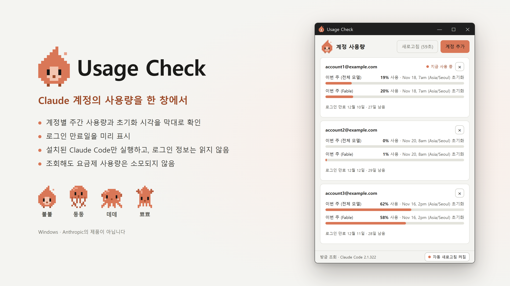
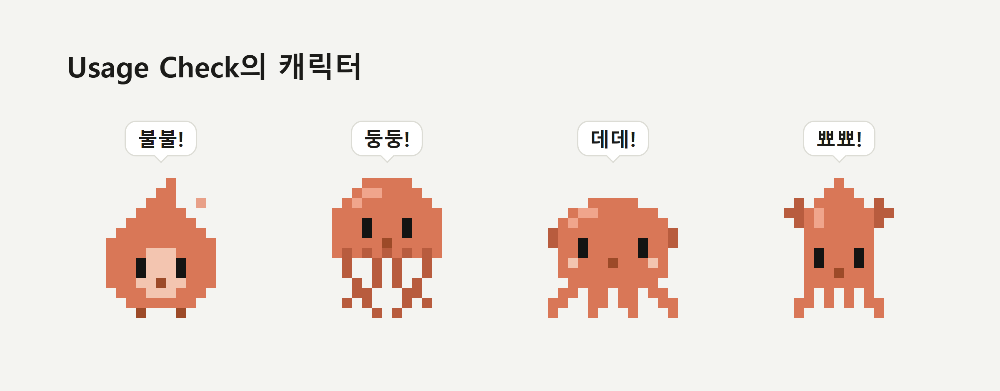

# Usage Check



내 Claude 계정의 사용량을 한 창에서 보여 주는 프로그램입니다. 등록한 계정마다 Claude Code의 `/usage` 화면에 나오는 주간 사용량 막대와 초기화 시각, 로그인 만료일을 보여 주므로, 터미널을 열어 `/usage`를 입력하지 않아도 지금 얼마나 썼는지 알 수 있습니다.

- 이 프로그램은 설치된 Claude Code를 실행하고 그 출력만 읽습니다. 사용량을 조회해도 요금제 사용량은 소모되지 않습니다.
- 본인 소유의 계정만 등록하십시오. Anthropic 약관은 계정을 다른 사람과 함께 쓰는 것을 허용하지 않습니다.

## 필요한 것

- Windows 10/11. macOS는 확인 예정이고, Linux는 지원하지 않습니다.
- [Claude Code](https://claude.com/claude-code) 2.1.318 이상
- [Node.js](https://nodejs.org) 22.12 이상
- [Git](https://git-scm.com)

## 설치와 실행

처음 한 번은 터미널에서 아래 네 줄을 실행합니다.

```
git clone https://github.com/emile-popcornsar/usage-check.git
cd usage-check
npm install
npm start
```

- `npm install`은 필요한 부품을 내려받는 단계로, 처음 한 번만 합니다.
- 처음에는 부품을 내려받느라 `npm install`이나 첫 `npm start`가 1~2분 걸릴 수 있습니다. 그다음부터는 몇 초 만에 열립니다.
- 다음에 열 때는 받아 둔 `usage-check` 폴더에서 `npm start`만 실행합니다.
- Claude Code를 쓰고 있다면 "usage-check 폴더에서 npm start 실행해 줘"라고 시켜도 됩니다.

## 자동 업데이트

`npm start`는 프로그램을 열기 전에 이 저장소에 새 내용이 있는지 확인하고, 있으면 받아서 적용한 뒤 엽니다. 따로 할 일은 없습니다.

- 지금 버전은 창 제목에 `Usage Check (v1.0.0)`처럼 표시됩니다.
- 인터넷이 연결되어 있지 않으면 지금 있는 버전으로 엽니다.
- 업데이트에 새 부품이 필요할 때는 `npm install`을 다시 실행하라는 안내가 나옵니다. 안내대로 한 뒤 `npm start`를 다시 실행합니다.
- 저장소를 ZIP 파일로 받은 폴더는 업데이트되지 않습니다. 위의 `git clone`으로 받으십시오.

## 사용 방법

### 계정 추가

1. 기본 브라우저에서 claude.ai에 등록할 계정(예: `account@example.com`)으로 먼저 로그인합니다.
2. 프로그램에서 [계정 추가]를 누르고, 브라우저에서 승인합니다.

등록되는 계정은 그 순간 브라우저에 로그인되어 있는 계정입니다. 계정은 PC마다 한 번씩 추가해야 합니다.

### 화면 읽는 법

계정마다 카드가 하나씩 생깁니다. 카드의 각 줄은 Claude Code의 `/usage`에 나오는 항목 그대로입니다.

| 화면 표시 | 뜻 |
| --- | --- |
| 막대와 `N% 사용` | 그 항목의 이번 주 사용률. 100%에 이르면 카드가 강조된다. |
| `… 초기화` | 사용량이 0으로 돌아가는 시각 |
| `지금 사용 중` | 이 PC의 Claude Code(터미널, VS Code)가 평소에 로그인해 있는 계정 |
| `로그인 만료 … N일 남음` | 이 프로그램에 등록한 로그인이 끝나는 날 |
| `로그인 필요` | 로그인이 끝났거나 풀린 상태. [다시 로그인]으로 갱신한다. |
| `N분 전 값`, `조회 실패` | 이번 조회가 실패해 마지막으로 읽은 값을 보여 주는 상태 |
| 아래쪽 `N분 전 조회` | 마지막으로 조회한 때 |

### 조작

- **새로고침**: [새로고침]은 누른 뒤 1분 동안 잠깁니다. 창이 보이는 동안에는 5분마다 자동으로 새로 고칩니다. 아래쪽 [자동 새로고침] 버튼으로 끄고 켤 수 있습니다.
- **카드 순서 바꾸기**: 카드를 끌어다 놓거나, 카드 안에서 `Alt` + `↑` / `↓`를 누릅니다.
- **화면 크기**: `Ctrl` + `+` / `-` 또는 `Ctrl` + 마우스 휠로 키우거나 줄이고, `Ctrl` + `0`으로 원래 크기로 돌아갑니다.
- **캐릭터 바꾸기**: 제목 왼쪽의 캐릭터를 누르면 불불, 둥둥, 데데, 뾰뾰 순서로 바뀌고, 바뀐 캐릭터가 말풍선으로 자기 이름을 말합니다.

자동 새로고침, 카드 순서, 화면 크기, 고른 캐릭터는 다음에 열어도 그대로입니다.



### 로그인 만료와 다시 로그인

로그인은 약 4주 동안 유지됩니다. 각 카드에 만료일이 표시됩니다. 만료가 3일 이내로 다가왔거나 이미 만료된 카드에만 [다시 로그인]이 나타나며, 이 버튼으로 갱신합니다. 이때도 브라우저가 그 계정으로 로그인되어 있어야 합니다.

### 계정 삭제

카드 오른쪽 위의 X를 누르고 확인 창에서 [삭제]를 고르면 목록에서 계정이 빠집니다. 이 프로그램용으로 만들어진 그 계정의 로그인도 함께 로그아웃되고 지워집니다. 평소에 쓰는 Claude Code나 VS Code의 로그인에는 영향이 없습니다.

### Claude Code를 찾지 못할 때

창에 찾지 못했다고 안내가 뜹니다. [경로 직접 지정]으로 위치를 알려 주거나 [다시 찾기]를 누릅니다.

## 지우는 법

1. 프로그램에서 계정을 하나씩 모두 삭제합니다.
2. 프로그램을 닫고 `usage-check` 폴더와 `%APPDATA%\Usage Check` 폴더를 지웁니다.

## 로그인 정보와 보안

- 이 프로그램은 로그인 정보를 읽거나 복사하거나 저장하거나 전송하지 않습니다.
- 자체 로그인 화면이 없습니다. 로그인은 Claude Code의 공식 화면에서 이루어집니다.
- 프로그램 자체는 네트워크 요청을 보내지 않습니다. 부품은 `npm install`과 첫 `npm start`가 내려받고, 그 뒤로는 `npm start`가 git으로 이 저장소의 새 내용을 받을 뿐입니다.
- 각 계정의 로그인은 Claude Code가 이 프로그램용으로 만든 계정별 폴더에 보관하며, 그 폴더는 운영체제의 앱 데이터 폴더에 있습니다.

이 프로그램은 Anthropic이나 Claude의 제품이 아니며, Anthropic과 제휴하거나 Anthropic의 승인을 받은 것이 아닙니다.

## 라이선스

[MIT](LICENSE)
